 

## 👋 Sobre mí

- 🎓 Estudiante de **Desarrollo de Aplicaciones Multiplataforma (DAM)** en el IES Hermanos Machado
- 💼 Prácticas y beca en **Formación y Control** (2026)
- 🔎 **Busco empleo** como desarrollador junior
- 🌍 Inglés: B1 Cambridge acreditado · nivel B2, certificación en proceso
- 🤝 Trabajo en equipo, liderazgo, empatía y resolución de conflictos
- 🚗 Carnet de conducir
- 🌱 Me gusta aprender tecnologías nuevas

## 🛠️ Tecnologías

  

## 🚀 Proyectos destacados

<table>
<tr>
<td width="50%" valign="top">

### 🌀 Endless Rift
Juego web de supervivencia por oleadas.

`React` `TypeScript` `Canvas` `Supabase`

[▶ Jugar](https://endless-rift.vercel.app) · [Código](https://github.com/ceta21/endless-rift)

</td>
<td width="50%" valign="top">

### ⛵ Galeon
Web corporativa de GALEON, consultora de inteligencia artificial.

`Next.js` `React` `TypeScript`

[🌐 Ver web](https://galeon-sable.vercel.app/) · [Código](https://github.com/ceta21/web-galeon)

</td>
</tr>
<tr>
<td width="50%" valign="top">

### 🏙️ Atraco 3D
Juego 3D de atracos y extracción para el navegador.

`JavaScript` `Three.js`

[Código](https://github.com/ceta21/atraco-3d)

</td>
<td width="50%" valign="top">

### 🏋️ ForgeFit
App de gimnasio instalable (PWA) con rutinas, entreno en tiempo real, progreso y coach con IA.

`React` `TypeScript` `Supabase`

[🌐 Probar](https://forgefit-app-gym.vercel.app)

</td>
</tr>
</table>

## 📚 Formación complementaria

- **CodeIgniter 4 desde cero:** CRUD, tienda online y API REST (Udemy, 64,5 h)
- **Desarrollo con IA:** Programa con Agentes y De 0 a Producción (BIG school)
- **Gestión de proyectos y metodología Agile** (Santander Open Academy)
- **Desarrollo Profesional en Data e IA** para la toma de decisiones empresariales (Escuela de Empresa)
- **Cursos de IA y prompting** de Google (Coursera)

---

📫 ¿Hablamos? Escríbeme por [LinkedIn](https://www.linkedin.com/in/gabrielvigorodriguez)

